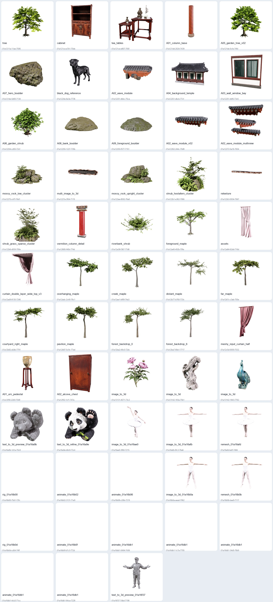

# QTMS_Meshmodels

Meshy 生成的 3D 模型归档，由 **FXGVR** 组织维护。

## 当前内容

- 任务记录：**59**
- 含模型的任务：**58**
- GLB 模型文件：**66**
- 模型预览图：**48**
- 模型与预览图大小：**1,491,557,759 bytes (1422.46 MiB)**
- 本次多 KEY 同步新增：**18 个任务、26 个 GLB**



## 目录结构

每个任务目录 `名称__任务ID/` 包含一个或多个 `*.glb` 模型、可用时的 `preview.png`、以及 `metadata.json`。绑定和动画任务可能包含多个 GLB 输出。

根目录：

- `index.html`：浏览器模型浏览页。
- `manifest.json` / `manifest.csv`：任务、模型、预览图和校验信息。
- `SHA256SUMS`：发布文件的 SHA-256 清单。
- `MULTI_KEY_SYNC.md` / `sync_reports/latest_library_sync.json`：多 KEY 同步记录。

## 克隆并下载模型

安装 Git LFS 后运行：

```bash
git lfs install
git clone https://github.com/FXGVR/QTMS_Meshmodels.git
cd QTMS_Meshmodels
git lfs pull
```

## 安全范围

- 所有 `*.glb` 通过 Git LFS 管理。
- 未提交 Meshy API KEY、授权头、临时签名 URL 或本机绝对路径。
- 本次同步只读取任务并下载已有结果，没有提交新的生成请求。
- 模型使用权和分发权遵循原始素材及 Meshy 相关条款。
